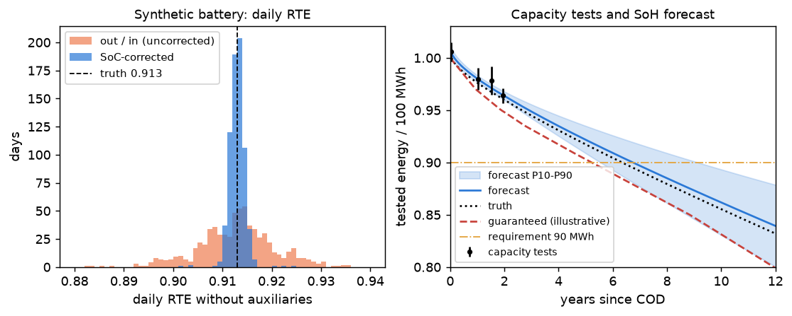
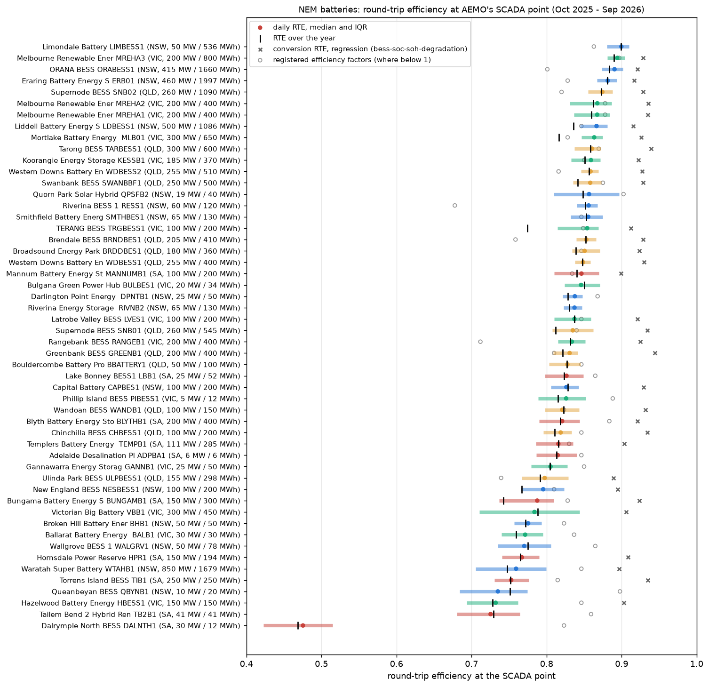
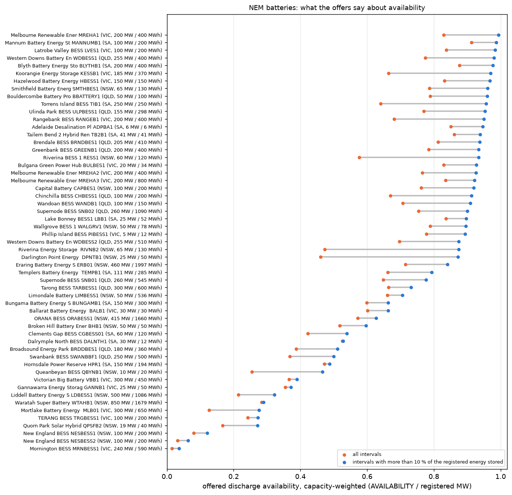
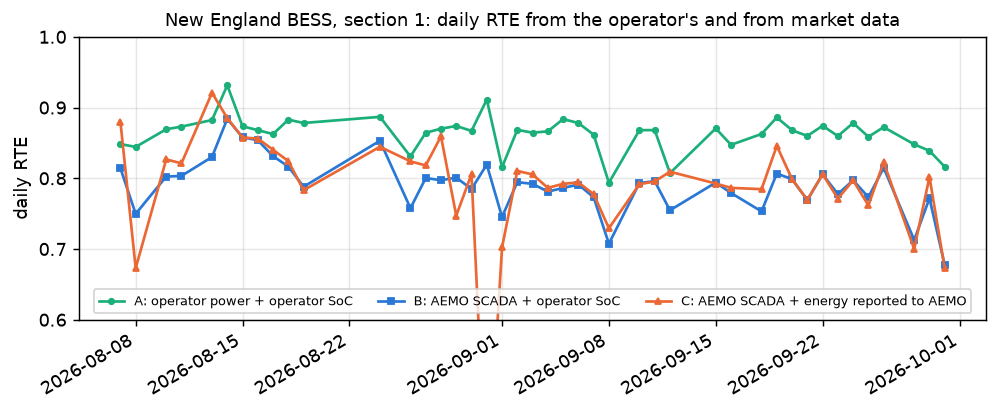

# Grid battery operations against warranty and LTSA

[](https://github.com/kwwaleszczynski-del/bess-ops-warranty/actions/workflows/ci.yml)

Once a battery is built, the asset manager's questions change from "what can it earn?" to "is it doing what the
contracts promise?". This project is a toolkit for those questions, written for the monthly reporting of an
operating grid battery:

1. **Round-trip efficiency at the meter**, with and without the auxiliaries (HVAC, transformers, control), in
   daily and monthly windows, corrected for the change of state of charge between the start and the end of the
   window; the auxiliary load against ambient temperature.
2. **Contractual availability** by the formulas typical of a long-term service agreement (LTSA): time-based,
   capacity-weighted and energy-based, with grid-operator instructions, force majeure and planned maintenance
   treated as the YAML says; illustrative liquidated damages (LD) for missed availability, RTE and capacity.
3. **Cycles and warranty conditions**: equivalent full cycles, rainflow counting, throughput, and the violations
   of the warranty's operating limits (cycles per year and day, throughput, SoC window, resting SoC, C-rate, cell
   and ambient temperature).
4. **Capacity tests**: evaluation, temperature correction, measurement uncertainty, a guard-band decision; the
   SoH trajectory against the guaranteed curve and a forecast of when the battery falls below a requirement, which
   is where the companion project [bess-capacity-augmentation](https://github.com/kwwaleszczynski-del/bess-capacity-augmentation)
   takes over.
5. **A benchmark of every grid battery in Australia's NEM** on public AEMO data, validated against an operator's
   own published data (ACEN's New England BESS), and a **verification on a synthetic battery** whose efficiencies,
   auxiliaries, outages and fade are known.

Input is a generic long table from any EMS or SCADA (`timestamp, device_id, signal, value`) with the column and
signal mapping, the site, the warranty and the LTSA in YAML files. Output is a monthly report in Excel and HTML.
Interactive dashboard and example report: https://kwwaleszczynski-del.github.io/bess-ops-warranty/

> Every contract term in this repository (warranty, LTSA, LD rates and caps) is an **illustrative placeholder**
> generalised from public sources, not a reading of any contract. Check every value against the actual documents.

## Key results

### 1. The estimators recover a battery whose truth is known

Two years of 15-minute EMS data of a 50 MW / 100 MWh battery, simulated from a physical energy balance and exported
like a real system would (kW and %, two PCS and BMS blocks, naive Europe/Warsaw timestamps with both DST changes):

| Quantity | Truth | Estimate |
|---|---|---|
| RTE without auxiliaries, each year | 0.91298 | 0.91298 / 0.91298 |
| RTE without auxiliaries, daily (median, 5-95 %) | 0.91298 | 0.91300 (0.911-0.915); uncorrected out/in: 0.899-0.927 |
| One-way efficiency used for the SoC correction (auto) | 0.9555 | 0.9555 |
| Auxiliaries: base load, heating below 12 degC, cooling above 18 degC, per MW of PCS power | 100 kW, 18 kW/K, 30 kW/K, 0.6 % | 100 kW, 18.0 kW/K at 12 degC, 30.0 kW/K at 18 degC, 0.60 % |
| Time-based availability, LTSA year 1 / 2 | 99.299 % / 96.760 % | 99.299 % / 96.760 % |
| Capacity tests at 25 degC (four tests, 21-31 degC) | 100.61 / 97.99 / 97.81 / 96.37 MWh | errors 0.002-0.044 MWh, expanded uncertainty 0.72-1.37 MWh |
| PCS and battery losses per month | from the simulation | within 0.11 % and 0.27 % |
| Year in which the tested energy falls below 90 MWh | 6.4 | 6.75 (P10-P90: 5.6-9.2) |

- **The SoC correction is what makes daily RTE usable.** Uncorrected, a day that ends fuller than it started looks
  inefficient and one that ends emptier looks better than physics allows: the daily ratio spreads over 2.8
  percentage points. Corrected, 90 % of the days are within 0.25 pp of the truth.
- **Auxiliaries decide whether the RTE guarantee is met.** Including auxiliaries the same battery has 0.859 and
  0.865 in its two years, but winter months fall to 0.831-0.841 because of heating, below the illustrative 85 %
  monthly guarantee: 19.5 and 10.6 thousand EUR of illustrative RTE damages per year at 90 EUR/MWh.
- **The availability formula is exact, including the DST days.** A forced outage across the 25-hour night of
  26 October 2025 counts five hours, one across the spring gap three. A ten-day transformer failure takes year 2 to
  96.76 %, below the illustrative 97 % guarantee (4.8 thousand EUR).
- **All injected warranty violations are found and nothing else**: 14 days above 2 cycles, an EMS resting at 100 %
  SoC for 74 hours, a 1.5-hour PCS overload at 0.58 C, an HVAC failure (cell temperature up to 47 degC, two events
  as it cooled below 40 degC overnight) and the annual limit of 365 cycles, passed on 29 November 2026. The four
  capacity tests also reach 100 % SoC; they are listed with the overlapping `capacity_test` event, because whether
  that is excused depends on the warranty.
- **The guard band matters at the first tests.** With a 0.2S meter, 0.2 % CTs and VTs and a 1 K temperature
  uncertainty the expanded uncertainty (k = 2) is 0.7-1.4 MWh, more than the margin of the first two tests over
  the guaranteed curve (0.6 and 1.0 MWh): their verdict is "inconclusive", not "pass".



### 2. NEM fleet: what a market data set says about efficiency, availability and cycling

55 batteries (8.9 GW, 20.3 GWh) with at least three operational months between October 2025 and September 2026.

**Round-trip efficiency at the SCADA point is 0.82 for the median battery (interquartile range 0.78-0.85), and
grows with duration**:

| Duration | Batteries | RTE over the year, median (range) | Conversion RTE from the regression of the companion project |
|---|---|---|---|
| about 1 h | 7 | 0.75 (0.47-0.81) | 0.919 |
| about 2 h | 41 | 0.83 (0.74-0.86) | 0.924 |
| 3 h or more | 5 | 0.88 (0.87-0.90) | 0.925 |

- The conversion efficiency is the same for all durations (0.92, from the hourly regression of reported stored
  energy in [bess-soc-soh-degradation](https://github.com/kwwaleszczynski-del/bess-soc-soh-degradation), which
  separates a standby drain). What the meter sees over whole days is 9 pp lower for the median battery (4 to
  18 pp): standby losses and auxiliaries taken through the connection point, which weigh more per MWh cycled in a
  one-hour battery (Torrens Island 0.75, Hazelwood 0.73) than in a four-hour one (Melbourne Renewable Energy Hub
  A3 0.89, Limondale 0.90).
- 95 % of the operational battery-months have a stored-energy report consistent with the metered energy (hourly
  regression, R² of at least 0.95); the median battery has 5 BMS recalibration jumps a month, which are removed
  before the SoC correction.



**Technically the batteries are available; commercially much less is offered.** For the 38 batteries in service
for at least six months (5.3 GW / 11.1 GWh, counted from the first month in which they declared 80 % of their
power), the physical availability declared with the bids (PASA), counted like an LTSA capacity formula (the lower of
the discharge and charge sides against registered power; near the SoC limits only the side that can still operate),
has a median of **95.8 %** (interquartile range 94.5-98.7 %, 96.1 % weighted by MW). 15 of the 38 reach an
illustrative 97 % guarantee and 26 reach 95 %; the median battery is declared out 217 hours a year.

| Same 38 batteries, same months | Median | Interquartile range |
|---|---|---|
| Technical availability (PASA, both directions, SoC-aware) | 95.8 % | 94.5-98.7 % |
| Offered discharge availability (`AVAILABILITY` / registered MW) | 78.1 % | 66.5-83.7 % |
| same, intervals with more than 10 % of the registered energy stored | 94.1 % | 89.6-97.5 % |
| Offered charge availability (`MIN_AVAILABILITY` / registered charge MW) | 80.7 % | 69.1-85.5 % |
| Declared available but not offered, share of registered MW | 15.5 % | 11.0-32.3 % |

- **What is held back is commercial, not technical.** The Victorian Big Battery offered 37 % of its power and
  Hornsdale 47 %, yet both declared 99-100 % physical availability: the difference (62 % and 53 % of their power) is
  capacity reserved for a system-integrity scheme and a government contract. A near-empty battery also offers less.
- **The state of charge matters for the declaration too.** Some operators declare almost no discharge capability
  when the battery is empty: counting both directions all the time, Chinchilla would have 58 % and Greenbank 72 %;
  SoC-aware, 84 % and 93 %. Wandoan declares 73 % of its registered charge power all year.
- **Commissioning.** Tarong and Eraring declared 0-24 % of their power for two to three months while they were
  already cycling in test; those months are excluded. Four batteries never declared 80 % in the year, and those in
  service for less than six months (Waratah, Orana among them) are not in the table.
- Offers in which a battery makes availability only when it intends to discharge (New England BESS section 1 offered
  at least half its power in 9 % of the intervals, yet cycled 199 times a year) make the offered availability a
  trading signal; the declared physical availability is the closest public proxy of what an LTSA would measure, but
  it is still the participant's statement.



**Cycling.** The median battery discharged 263 equivalent full cycles a year at the SCADA point (rainflow on the
reported energy: 313), three above 365 (rainflow: twelve). The median battery spent 6 % of the time at 95 % or more
of its registered energy and 15 % at 5 % or less.

**Usable energy over time** (99.5th percentile of the reported stored energy, as a share of the registered energy,
from the first month at full range): for 26 of 39 batteries with at least six such months the trend is within
+-3 % of the registered energy per year, for 15 within +-1 %. The outliers are changes of the operating window
(Limondale +18 %/yr, Wallgrove -26 %/yr), not fade: the envelope follows the operator's SoC limits.

### 3. Validation with the operator's own data: New England BESS

ACEN publishes 5-minute power and SoC of both 100 MW / 200 MWh sections. Daily RTE computed three ways separates the
metering point from the source of the stored energy:

| New England BESS section 1, 6 Aug - 30 Sep 2026 (43 days) | Daily RTE, median |
|---|---|
| A: operator's power and operator's SoC | 0.868 |
| B: AEMO SCADA and operator's SoC | 0.794 |
| C: AEMO SCADA and the stored energy reported to AEMO (the benchmark) | 0.799 |

- **The source of the stored energy hardly matters for the median (B vs C: 0.794 vs 0.799, 3.1 pp mean absolute
  daily difference); the metering point does (A vs B: 7.3 pp).** AEMO's SCADA sees 2-5 % less energy discharged
  and 4-13 % more charged than the operator's data (June-September, both sections), consistent with a measurement at the connection point that
  includes transformer losses and auxiliaries, against the operator's at the battery side. A monthly RTE from
  market data is an RTE including auxiliaries; it cannot be compared with an RTE guaranteed at the PCS terminals.
- **The consistency check finds the faulty reports by itself.** The day-by-day check (correlation of the hourly
  change of reported energy with the hourly metered net charge) places the first correct report of both sections
  on 6 August 2026, the date documented in the companion project for section 1; before it, both reported the
  headroom instead of the stored energy. The monthly check flags April-July 2026 (section 1) and June-July 2026
  (section 2).
- The operator's SoC corresponds to 251-252 MWh of usable energy per section (fit of SoC changes against metered
  energy), against 200 MWh registered with AEMO. Rainflow cycles agree once both are on the registered 200 MWh
  (44 from the operator's SoC, 49 from the reported energy); the level of the reported energy does not: it is at or
  below 5 % for 17 % of the time, the operator's SoC for 3 %. A SoC-window warranty check on market data is not
  possible.



## Method

The interval flows, the SoC-corrected RTE, the LTSA availability, rainflow and throughput, the capacity
test evaluation, the guaranteed retention and the damages are computed by
[res-asset-kpi](https://github.com/kwwaleszczynski-del/res-asset-kpi) (`res_asset_kpi.bess`,
`res_asset_kpi.contracts`), the KPI library extracted from this and five related projects.

### Energy and round-trip efficiency

Metered power `P` (+ export) gives, per interval of `dt` hours, energy out `max(P, 0) dt` and in `max(-P, 0) dt`.
With the auxiliaries behind the revenue meter the PCS flow is `P + P_aux`; with a separate supply their energy is
added to the input. Over a window (a local calendar day, month or LTSA year) with energy out `E_out`, in `E_in` and a
change of stored energy `dE` (from SoC times the SoC energy, or a reported stored energy):

```math
\mathrm{RTE} =
\begin{cases}
\dfrac{E_{out} + \eta\,\Delta E}{E_{in}} & \Delta E \ge 0 \\[2ex]
\dfrac{E_{out}}{E_{in} + |\Delta E|/\eta} & \Delta E < 0
\end{cases}
```

the energy left in store is worth $`\eta \Delta E`$ at the meter, the energy taken from store would need
$`|\Delta E|/\eta`$ to refill. The one-way efficiency $`\eta`$ is given or found as the fixed point
$`\eta = \sqrt{\mathrm{RTE}}`$ of the whole record. Windows with fewer than 0.3 cycles a day (5 a month) are not
assessed: on idle days auxiliaries and the SoC resolution dominate.

**Energy balance.** `E_in = E_out + dE + losses`; with auxiliary and DC signals the losses split into auxiliaries,
PCS (`E_in,pcs - E_dc,ch + E_dc,dis - E_out,pcs`) and battery (`E_dc,ch - E_dc,dis - dE`). A negative battery term
means the SoC scale or the DC measurement does not fit the metered energy.

**Auxiliaries against temperature.** Hourly auxiliary power (metered, or the import at the meter when the battery
is idle) is fitted with break points found by grid search and non-negative least squares:

```math
P_{aux} = b_0 + h\,\max(T_h - T, 0) + c\,\max(T - T_c, 0) + k\,|P_{pcs}|
```

**BMS jumps and inverted reports.** Hourly changes of the stored energy are regressed on the charged and discharged
energy, $`\Delta E_h = a E_{in,h} - b E_{out,h} - c`$. Residuals above 5 % of the capacity that persist for two
hours are jumps (recalibrations) and are subtracted from the state after them; residuals that reverse within two
hours are timing offsets and are left alone. A month is consistent when $`a, b > 0.5`$ and $`R^2 \ge 0.95`$; a day is
inverted when the hourly correlation of the state change with the net charge is below -0.5.

### Availability and liquidated damages

Per interval the measured availability `a_i` follows from the available power in each direction against the
contracted power `P_c` (and for the energy formula the available energy against `E_c`):

```math
a_i^{time} = \mathbf{1}\left[\min_d \frac{P_{avail,d}}{P_{c,d}} \ge \theta\right], \qquad
a_i^{cap} = \min_d \min\left(1, \frac{P_{avail,d}}{P_{c,d}}\right), \qquad
a_i^{energy} = a_i^{cap}\,\min\left(1, \frac{E_{avail}}{E_c}\right)
```

Events from the operator's log set the treatment: `deemed_available` (`a_i = 1`, e.g. instructions of the grid
operator), `excluded` (out of numerator and denominator, e.g. force majeure, the capacity test), `allowance`
(planned maintenance, excluded up to the allowance of the period, pro rata, counted afterwards) and `counted`
(forced outages). Then $`A = \sum a_i \Delta t_i / \sum \Delta t_i`$ over the intervals not excluded. Missing data
without an event are excluded, unavailable or available, as configured.

Illustrative damages: availability `rate x shortfall in pp` (optionally per MW); RTE either `rate x shortfall in pp`
or the cost of the extra energy, $`E_{out}\,(1/\mathrm{RTE} - 1/\mathrm{RTE}_g)\,p`$; capacity `rate x MWh short` per
failed test; the total per LTSA year capped at a share of the annual fee. The monthly report shows everything as
it stood at the end of its month.

### Cycles and warranty conditions

Equivalent full cycles on the warranty's basis (discharge at the meter or DC, or half the throughput) per reference
energy; rainflow counting of the SoC by ASTM E1049 (three-point method, residue as half cycles, optional hysteresis
filter). Violations are runs of intervals outside a limit lasting at least the tolerated time, or daily and
warranty-year totals above a limit. The guaranteed state of health is read from the warranty's retention table at
the equivalent age $`\max(t, N/N_{yr})`$ when the warranty counts throughput (`N` cycles so far, `N_yr` the annual
allowance).

### Capacity tests and the SoH forecast

A test is a full discharge at the test power (from the event log, or found in the data: steady power, starting at
or above 97 % and ending at or below 3 % SoC). The discharged energy at the meter (or DC, optionally with the
auxiliary energy added back) is corrected to the reference temperature, and its uncertainty combined from
rectangular error limits of meter, CTs and VTs and the temperature correction:

```math
E_{corr} = \frac{E_{meas}}{1 + \alpha\,(T - T_{ref})}, \qquad
u_c = \sqrt{\left(\frac{\varepsilon_m}{\sqrt 3}\right)^2 + \left(\frac{\varepsilon_{CT}}{\sqrt 3}\right)^2
+ \left(\frac{\varepsilon_{VT}}{\sqrt 3}\right)^2 + (\alpha\,u_T)^2 + (u_\alpha\,|T - T_{ref}|)^2}
```

With a guard band the test passes when $`E_{corr} - k u_c E_{corr} \ge E_g`$, fails when
$`E_{corr} + k u_c E_{corr} < E_g`$ and is inconclusive in between. The tests are then fitted with the fade law of
bess-capacity-augmentation (calendar ageing with the square root of time, cycle ageing linear in cycles):

```math
\mathrm{SoH}(t) = s_0 - a\sqrt{t} - b\,\frac{N(t)}{1000}
```

by weighted least squares with a Gaussian prior on `a` and `b`: the LFP cell fit of that project (calendar
1.64e-3 per square root of a day, cycling 2.1e-5 per cycle at 25 degC, Arrhenius-scaled to the site's mean cell
temperature, 50 % standard deviation). Two or three tests, in which time and cycles grow together, cannot separate
the two terms on their own. The forecast extends `N(t)` at the cycling rate of the last 12 months and gives the
first month below the requirement and below the guaranteed curve (P10, P50, P90 of the SoH band).
`augmentation_handoff.json` hands the fitted rates over as the `k_cal` and `k_cyc` of
`bess_augment.aging.AgingModel` (25 degC reference), so the cheapest response (augmentation, overbuild, operating
limits) can be planned with the measured fade instead of the cell-lab one.

### NEM benchmark

The cache of [nem-battery-behaviour](https://github.com/kwwaleszczynski-del/nem-battery-behaviour) (AEMO MMSDM,
October 2025 - September 2026) is read as the same canonical signals: `DISPATCH_UNIT_SCADA.SCADAVALUE` (instantaneous
MW at the interval start; energy of an interval is the trapezoid between two readings, split exactly at zero
crossings) as the meter, `DISPATCHLOAD.INITIAL_ENERGY_STORAGE` as the stored energy, `DISPATCHLOAD.AVAILABILITY`
(the offered discharge availability) and the registered discharge MW, charge MW and MWh of `DUDETAIL`, valid per
day. `fetch-nem` adds, per battery and 5-minute interval, the offered charge availability
(`DISPATCHLOAD.MIN_AVAILABILITY`) and from the final energy bids (`BIDPEROFFER_D`) the offered (`MAXAVAIL`) and the
declared physical availability (`PASAAVAILABILITY`) in each direction. The technical availability is the LTSA
capacity formula applied to PASA: $`a_i = \min\left(1, \mathrm{PASA}_{gen}/P_{dis}, \mathrm{PASA}_{load}/P_{ch}\right)`$;
"declared but not offered" is the mean of $`\max(0, \mathrm{PASA}_{gen} - \mathrm{AVAIL})/P_{dis}`$. NEM time is AEST
(UTC+10) without DST. A month is operational with at least one cycle and 20 days of data.

## Use it on your own data

```bash
python -m bess_ops demo --out out/demo        # writes a synthetic export, the YAML files and the report
python -m bess_ops run out/demo/ems_long.parquet --mapping out/demo/config/mapping.example.yaml \
    --site out/demo/config/site.example.yaml --warranty out/demo/config/warranty.example.yaml \
    --ltsa out/demo/config/ltsa.example.yaml --events out/demo/events.csv --month 2026-08 --out out/report
```

**Input table** (Parquet or CSV), one row per timestamp, device and signal; the names of the four columns are set in
the mapping. Canonical signals (only `p_meter` is required; each estimator says which signals it needs):

| Signal | Meaning | Unit | Devices combined by |
|---|---|---|---|
| `p_meter` | active power at the revenue meter, + export | MW | sum |
| `p_dc` | DC power at the battery terminals, + discharge | MW | sum |
| `p_aux` | auxiliary consumption | MW | sum |
| `soc` / `e_stored` | state of charge / stored energy | fraction / MWh | mean / sum |
| `t_amb`, `t_cell_max`, `t_cell_avg` | ambient, highest and mean cell temperature | degC | mean, max, mean |
| `p_avail_dis`, `p_avail_ch`, `e_avail` | available discharge and charge power, available energy | MW, MWh | sum |

**Mapping** ([`mapping.example.yaml`](src/bess_ops/examples/mapping.example.yaml)): for each canonical signal your
signal name, a scale (kW to MW: 0.001, % to fraction: 0.01), an offset, a sign, the devices to use and how to
combine them, and whether the value is an interval mean or an instantaneous reading.

**Time.** Naive timestamps are local time in the mapping's time zone (default Europe/Warsaw); in autumn the hour
02:00-03:00 occurs twice and the first occurrence of each timestamp (per device and signal) is summer time, as in a
chronological export; timestamps in the spring gap are an error. ISO timestamps with an offset are taken as they
are. Mean values may be labelled by the start or the end of their interval. Days, months and LTSA years of the
report are local (a day has 23, 24 or 25 hours).

**Site, warranty, LTSA** ([`site`](src/bess_ops/examples/site.example.yaml),
[`warranty`](src/bess_ops/examples/warranty.example.yaml), [`ltsa`](src/bess_ops/examples/ltsa.example.yaml)): ratings,
the energy behind SoC 100 %, where the auxiliaries are metered, the commercial operation date; the warranty's
throughput basis, limits and retention table; the availability formula, event treatments, guarantees, test
procedure, the energy requirement for the forecast (for example the energy behind a capacity-market obligation;
the Polish capacity-market rules change often and must be checked for the contract at hand) and LD rates. Unknown
keys are an error.

**Event log** (CSV): `start, end, category[, note]` in local time; categories as in the LTSA file
(`tso_instruction`, `grid_outage`, `owner_request`, `force_majeure`, `capacity_test`, `planned_maintenance`,
`forced_outage`, or your own).

**Outputs**: `report_<month>.xlsx` (KPI sheet with guarantees and conditional formatting, monthly KPIs, daily
energy and RTE, violations, LD per LTSA year and items, capacity tests, SoH forecast, energy balance, availability,
auxiliary model, data quality), `report_<month>.html` (the same as a self-contained page), CSV tables and
`augmentation_handoff.json`. Paths are only command-line arguments; no file locations are built into the code.

## Limitations

- **Contract terms are illustrative.** The formulas are common shapes of LTSA and warranty clauses; real contracts
  differ in the details that decide money (what counts as an outage, partial availability, test conditions, how
  LD are capped and offset). Every term is a YAML value to be set from the contract.
- **What market data cannot show.** The NEM benchmark has no auxiliary metering behind the connection point, no
  temperatures, no capacity tests, no outage log and no warranty terms. Its RTE includes whatever the SCADA point
  includes; its offered availability is a trading decision; its technical availability is the physical availability
  the participant declares with its bids (PASA), which is the participant's statement, not a measurement, and does
  not say why a unit was out (forced, planned, grid); its "usable energy" is the operator's operating window.
- **Reported stored energy is the operator's number.** It follows the BMS, which recalibrates, and some operators
  report it wrongly for months; the checks find inconsistent months and jumps, not a consistent bias of the
  scale. The level of the reported energy did not match the operator's SoC at New England BESS.
- **SoC correction.** The one-way efficiency is assumed symmetric and constant; with a wrong SoC energy scale the
  correction of each window is off by that factor of `dE` (small for months, visible for single days).
- **Synthetic verification** shows that the estimators are consistent with the physics they assume (constant
  efficiencies, a smooth auxiliary model, fade by the same law as the forecast). Real batteries have part-load
  efficiency curves, self-discharge, cell imbalance and SoC drift; the forecast of a real battery inherits the
  uncertainty of the fade law and of the prior from one LFP cell type.
- **Capacity-test uncertainty** covers the instrument classes and the temperature correction, not the test
  procedure itself (rest time, SoC calibration before the test), which can matter more.

## Data

| Source | Content | Licence | Size |
|---|---|---|---|
| AEMO MMSDM archive, NEMWeb (cache of nem-battery-behaviour) | 5-min SCADA, dispatch results incl. stored energy and availability, registrations, Oct 2025 - Sep 2026 | [AEMO copyright permissions](https://www.aemo.com.au/privacy-and-legal-notices/copyright-permissions) (use with attribution) | 125 MB cache |
| AEMO MMSDM archive, `DISPATCHLOAD` and `BIDPEROFFER_D` (`fetch-nem`) | charge-side offered availability, offered and declared physical (PASA) availability per direction of every battery, Oct 2025 - Sep 2026 | as above | 3.55 GB download, filtered on the fly |
| [ACEN Australia, New England BESS operational data](https://acenrenewables.com.au/new-england-bess-operational-data/) (files of bess-soc-soh-degradation) | 5-min power and SoC of both sections, May - Sep 2026 | none stated; used locally, not redistributed | 5 MB |
| Synthetic battery (`bess_ops.synthetic`) | two years of 15-min EMS data, events, ground truth | generated on the fly | - |

Only derived numbers are in the repository (`results/`, `docs/`); no raw data.

## Run it

```bash
python -m venv .venv
.venv/Scripts/pip install -e ".[dev]"          # .venv/bin/pip on Linux/macOS
pytest -q                                      # 44 tests, no network, about 30 s
python -m bess_ops verify                      # synthetic battery vs ground truth -> results/verification.json
python -m bess_ops fetch-nem --registry ../nem-battery-behaviour/data/registry.parquet --out data/nem_extra --jobs 4
python -m bess_ops nem --nem-data-dir ../nem-battery-behaviour/data --nem-extra-dir data/nem_extra \
    --acen-dir ../bess-soc-soh-degradation/data/acen \
    --regression-results ../bess-soc-soh-degradation/results/fleet_reported_soc_summary.csv
python -m bess_ops site                        # charts, docs/data.js and the example report in docs/report/
```

`--nem-data-dir` and `--acen-dir` can also come from `BESS_NEM_DATA_DIR` and `BESS_ACEN_DIR`. The NEM cache is built
by nem-battery-behaviour (`python -m nem_battery fetch`, about 1.9 GB of download); the ACEN files (one CSV per
month, linked on ACEN's page) are downloaded by bess-soc-soh-degradation. The fleet run takes about two minutes.

```
src/bess_ops/
  schema.py        long table -> site frame: mapping, time zones and DST, data quality
  config.py        site, warranty and LTSA YAML with defaults
  energy.py        windows, energy balance, SoC-corrected RTE, BMS jumps, inverted reports
  auxiliaries.py   auxiliary consumption against ambient temperature
  availability.py  LTSA availability from the configuration (formulas in res-asset-kpi)
  ld.py            illustrative liquidated damages
  cycles.py        throughput basis of the warranty (rainflow in res-asset-kpi)
  warranty.py      warranty conditions and their violations, warranty status
  capacity.py      capacity tests, uncertainty, fade fit and forecast, hand-over to bess-capacity-augmentation
  pipeline.py      all estimators on one site, state at a month end
  report.py        monthly Excel and HTML report
  synthetic.py     the synthetic battery
  nem.py, acen.py  NEM fleet benchmark, validation with ACEN's data
  mms.py           download of charge-side and physical availability from the AEMO archive
  study.py, site.py, cli.py
  examples/        mapping, site, warranty and LTSA YAML
tests/             no network
```

## License and attribution

Code: MIT. Data: Australian Energy Market Operator (AEMO), MMSDM data archive; ACEN Australia, New England BESS
operational data. Results are derived from this material; neither provider is responsible for this analysis.
